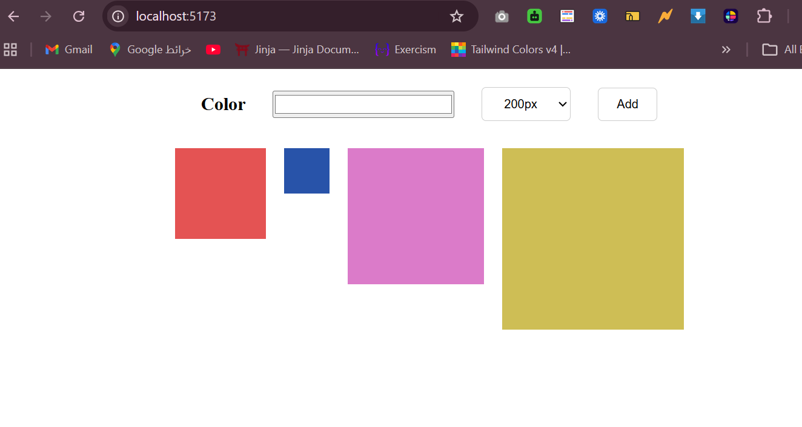

# Box Generator
A simple interactive React application that allows users to create colored boxes with customizable dimensions.

## Features
- Choose a box color using a color picker.
- Select the width and height of each box.
- Add multiple boxes with different colors and sizes.
- Display all generated boxes on the page.
- Reset the color selection after adding a box.

## Technologies Used
- React.js
- JavaScript
- HTML
- CSS
- Vite

## Screenshot
