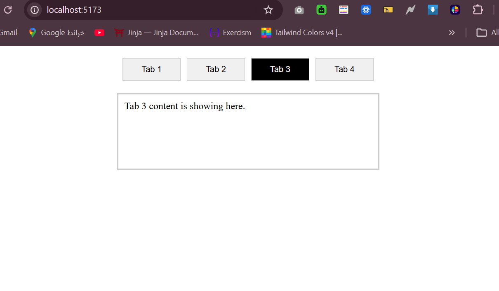

# Tabs
A customizable and reusable Tabs component built with React, CSS Modules, and smooth transition animations.

## Features
- Accepts an array of varying length to generate tabs dynamically.
- Highlights the currently selected tab with a distinct active style.
- Supports custom callback functions triggered on individual tab clicks.
- Includes CSS / JS animations for a seamless user experience when switching between tab.

## Technologies Used
- React.js
- JavaScript
- HTML
- CSS
- Vite

## Screenshot

